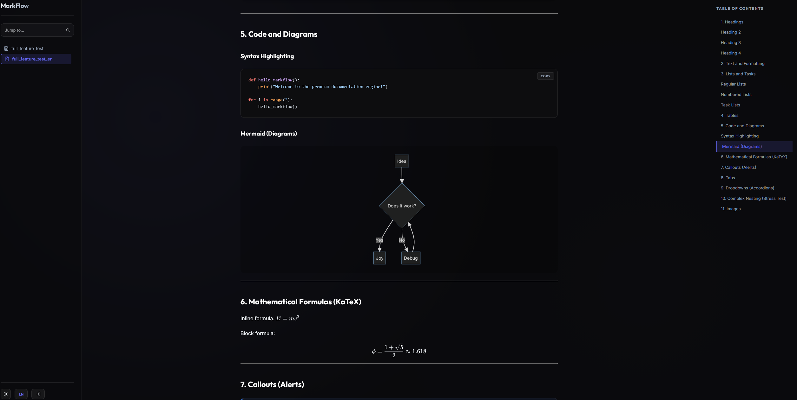

# 🌊 MarkFlow

**MarkFlow** is a modern, self-hosted Markdown knowledge base editor with native Git synchronization.



## ✨ Key Features

*   **📝 Markdown Editor**: Notion-like clean writing experience with split views and rich formatting.
*   **🔄 Native Git Sync**: Effortlessly synchronize documentation with remote Git repositories.
*   **🔎 Instant Search**: Real-time full-text search across all your documents.
*   **🔐 Security First**: Built-in Two-Factor Authentication (TOTP) and encrypted SSH key management.

## 🐳 Deployment (Docker)

MarkFlow ships with a production-grade deployment suite featuring an Nginx reverse proxy and automated Let's Encrypt SSL (Certbot).

### 1. Quick Start
Run the interactive setup script from the root directory:
```bash
git clone https://github.com/blackalex1/MarkFlow.git
cd MarkFlow
bash deploy/setup.sh
```
The script will guide you through:
- Configuring ports (HTTP/HTTPS).
- Setting up your domain name.
- Initializing SSL certificates via Let's Encrypt.

### 2. Maintenance
- **Update**: `bash update.sh`
- **Rebuild**: `bash deploy/rebuild.sh`

Default access: `http://your-domain` (Login: `admin` / See random password in logs on first run).

---

[Русская версия (Russian Version)](README_RU.md)
